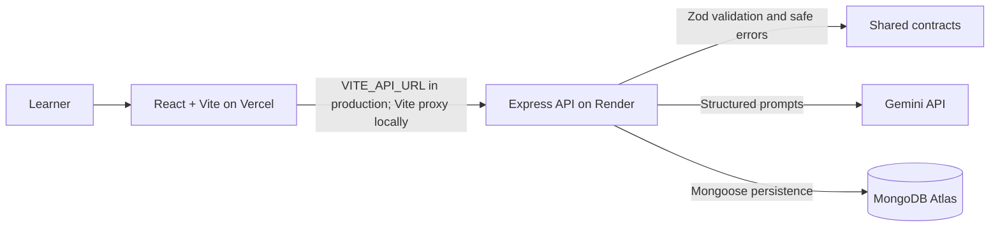

# Architecture

## Runtime topology



The browser has no Gemini or MongoDB credentials. In local development, Vite proxies `/api` to `localhost:5000`. In a deployment, `VITE_API_URL` points the client to the Render API origin.

## Request path

The API applies Helmet headers, request IDs and structured request logs, and exact-origin CORS before its routes. JSON bodies are capped at 16 KB. Both generation endpoints share a per-IP rate limit. The server validates course input and model output with shared Zod contracts, then persists only valid output. Errors include a request ID and a safe message; logs omit prompts, request bodies, keys, and raw provider responses.

The rate limiter uses process memory. That is suitable for the current single-instance demo but resets on restart and does not coordinate multiple API instances. Use a shared store before horizontal scaling. CORS controls which browser origins can read API responses; it does not provide authentication. Courses are public to anyone with a course ID because this demo has no accounts or ownership model.

## Course-generation flow

```text
Topic and learner level
  → shared request schema in the browser and API
  → Gemini structured course outline
  → shared response schema (one bounded repair attempt)
  → MongoDB persistence
  → reloadable course outline and lesson list
  → on-demand lesson content generation
  → validated lesson blocks, quiz interaction, and MongoDB cache
```

`POST /api/courses` requests exactly three modules with three lessons each. Invalid input is rejected before calling Gemini. If Gemini returns malformed or schema-invalid data, the server makes one repair request and persists only a valid outline. `GET /api/courses/:courseId` validates the identifier before reading MongoDB.

`POST /api/courses/:courseId/lessons/:lessonId/content` validates both IDs, loads the selected lesson, and generates details only on demand. Valid content and its timestamp are saved on the lesson; later requests return the cached content. Lesson output includes heading, paragraph, optional code, a video-search query, and four trailing multiple-choice questions.

## Health checks and errors

- `GET /api/health/live` indicates that the Express process is serving requests.
- `GET /api/health/ready` reports whether the MongoDB connection is ready.
- Input and ID validation errors return `400`; unknown courses or lessons return `404`; quota exhaustion returns `429`; missing service configuration returns `503`; provider failures return safe `502` responses.
- Every API response receives an `X-Request-Id`. JSON logs include the request ID, method, path, status, and duration without recording request data.

## CI and deployment

GitHub Actions runs linting, Node's test runner, and client/server builds. Tests mock the Gemini adapter. A MongoDB service container exercises the real course and lesson persistence flow in CI.

`render.yaml` configures the Node API service and its liveness endpoint. `vercel.json` builds the static client from the monorepo root. See [deployment setup](deployment.md), [acceptance checks](acceptance-checklist.md), and the [demo walkthrough](demo-script.md).

## Workspace responsibilities

- `client/` — React interface, Vite proxy, and client-side API/schema boundary
- `server/` — Express routes, middleware, Gemini adapters, Mongoose model, and tests
- `shared/` — request, course, and lesson schemas shared by browser and API
